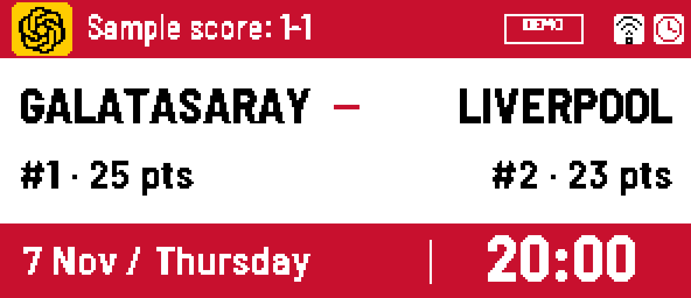
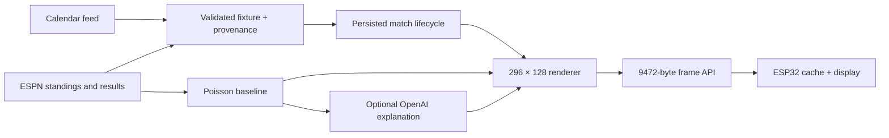

# Matchday Ink

A self-hosted football companion built with an ESP32-C3, a four-colour e-paper display, and a custom 3D-printed enclosure.

**Built collaboratively with OpenAI Codex.** I defined the product requirements, integrated the hardware, iterated on the enclosure, and performed physical acceptance checks. Codex assisted with implementation, debugging, tests, and documentation. See [development with Codex](docs/ai-assisted-development.md).



*Illustrative Galatasaray–Liverpool fixture. Date, standings and score are synthetic; this is a rendered layout preview, not a photograph or a real fixture/prediction.*

## What it does

- Shows the next Galatasaray fixture, competition standings, and local kickoff time.
- Keeps the current match until confirmed completion plus a five-minute observation buffer.
- Preserves the last valid screen when downloads fail and reconnects after power loss.
- Calculates experimental home/draw/away probabilities and a most likely score.
- Optionally uses OpenAI to explain the statistical forecast; AI does not generate the probabilities.
- Provides local USB Wi-Fi provisioning and a browser preview.

The assembled prototype has been tested by its owner. This repository is a review candidate: a fresh end-to-end installation and remote CI run are still release gates. No predictive accuracy is claimed.

## Engineering focus

This project explores a supportable integration across external data, an optional AI API, a local server and physical hardware. The useful evidence is how failures are isolated and recovered:

- [Display-refresh investigation](docs/incident-display-refresh.md): distinguish a successful download from the actual user-visible outcome.
- [Support runbook](docs/support-runbook.md): check server, data, network, device and AI boundaries without exposing credentials.
- [Verification record](docs/verification.md): separate local checks, physical observations and remaining release gates.

## Supported build

| Component | Supported configuration |
| --- | --- |
| Controller | ESP32-C3 SuperMini |
| Display | Waveshare 2.9-inch e-Paper Module (G), 296 × 128, black/white/red/yellow |
| Server | Python 3.11+; macOS startup installer |
| Power | Continuous USB; no battery |
| Football | Galatasaray; supported competition mappings only |
| Enclosure | Bambu Lab A1, 0.4 mm nozzle, Bambu PLA Matte |

The server computer must remain awake and reachable on the same trusted LAN. The frame API uses HTTP, not TLS; this release is not designed for public Internet exposure. Other teams, boards, and operating systems are not verified.

## Parts and tools used

### Parts and materials

| Item | Quantity | Notes |
| --- | --- | --- |
| ESP32-C3 SuperMini development board | 1 | USB-C; check your board variant against the wiring guide |
| Waveshare 2.9-inch e-Paper Module (G) | 1 | SPI driver board; 296 × 128; black, white, red and yellow |
| Jumper wires / display connection cable | 1 set | Eight connections between the ESP32 and display module |
| USB-C data cable | 1 | Required for firmware installation and Wi-Fi provisioning; also supplies power |
| USB power adapter | 1 | Powers the finished device continuously; no battery required |
| Printed enclosure and ESP32 carrier | 1 set | Front, body, rear and carrier; see the curated CAD files |
| Printed mounting repair feet | 2 | Align the carrier with the USB opening; included in the CAD set |
| Self-tapping screws | As required | M2×4 mm for the repair feet and display retainers; dry-fit and check penetration before tightening |
| PLA filament | As required | Bambu PLA Matte was used; colour is your choice |
| Cyanoacrylate adhesive | Small amount | For the separate carrier mounting feet; remove electronics before applying |

### Tools and host

- Bambu Lab A1 3D printer, 0.4 mm nozzle, and textured build plate.
- Bambu Studio for reviewing and slicing the supplied print projects.
- Small Phillips screwdriver and a ruler or caliper for fit checks.
- A macOS computer for the local Python server, USB setup and firmware installation.
- A 2.4 GHz Wi-Fi network accessible to the ESP32 and server computer.
- Python and Arduino CLI; versions and installation steps are in the setup guide.
- OpenAI Codex for AI-assisted development; an OpenAI API key is optional for runtime commentary.

Exact shopping links and a total build cost are not included: board variants and local prices differ. See [hardware and assembly](docs/hardware.md) for wiring and mounting details. The first release does not include a battery or charging module.

## Try it without hardware or API keys

```sh
python3 -m venv .venv
source .venv/bin/activate
python -m pip install -e '.[dev,ai,device]'
matchday-ink demo
matchday-ink render --schedule build/demo.json
matchday-ink serve --schedule build/demo.json
```

Open [the demo](http://127.0.0.1:8000). `127.0.0.1` (localhost) always means the computer you are using, so this address works unchanged when you run the server locally. The ESP32 needs your computer’s actual LAN address instead; follow the installation guide to find it. Fixtures are synthetic and explicitly labelled. The optional extras install development, OpenAI, and USB dependencies; no paid calls happen in this demo.

For the real device, follow [Getting started](docs/getting-started.md).

## Architecture



The server owns data retrieval and layout. The ESP32 owns connectivity, frame validation, caching, and physical refresh. Screen changes normally require no firmware update.

## Development checks

```sh
python -m ruff check src tests scripts
python -m pytest -q
```

Tests use synthetic or fixture data; ordinary test runs do not require credentials or paid API calls. CI also builds the firmware and checks package installation. A workflow definition is not evidence of a successful GitHub run.

## Documentation

- [Installation and recovery](docs/getting-started.md)
- [Hardware and printing](docs/hardware.md)
- [Configuration and credentials](docs/configuration.md)
- [Architecture and API](docs/architecture.md)
- [Prediction methodology and limitations](docs/prediction.md)
- [Development and verification](docs/development.md)
- [Support runbook](docs/support-runbook.md)
- [Display-refresh case study](docs/incident-display-refresh.md)
- [Codex collaboration and engineering decisions](docs/ai-assisted-development.md)
- [Reusable build prompt](PROMPT.md) — a retrospective brief you can adapt and copy into a coding assistant
- [Third-party notices](THIRD_PARTY_NOTICES.md)

## Data and limitations

Upcoming fixtures come from a public Fixtur.es calendar. ESPN adapters provide same-competition standings, results, and completion status. These are external services with no availability guarantee; undocumented endpoints and HTML can change. Source timestamps and identities are retained rather than replaced with fabricated values. Missing standings remain unavailable.

The statistical model itself requires no OpenAI key, but the current live orchestration enables the baseline and commentary together through the AI setting. Separating those controls is a follow-up. AI explanations currently cache for 24 hours per fixture/model/prompt, not strictly once per match. API use may incur charges. No cloud hosting, OTA updater, or battery support is included.

## License and affiliation

Original project code is MIT licensed. Third-party assets and vendor code retain their own notices. This is an independent fan project, not affiliated with Galatasaray, UEFA, ESPN, Fixtur.es, or OpenAI. Club and product names remain their owners' trademarks.
