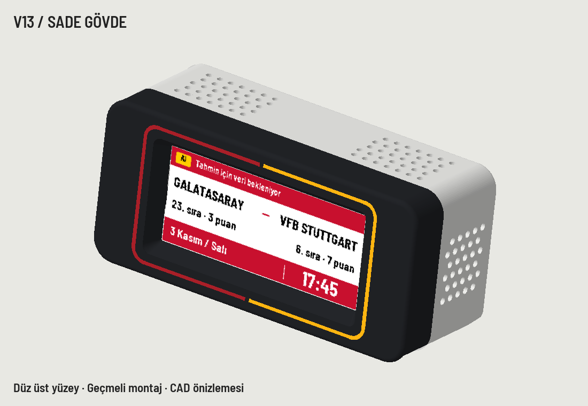

# Hardware and enclosure

## Wiring

Disconnect power before changing connections.

| Waveshare | ESP32-C3 GPIO |
| --- | --- |
| VCC | 3.3 V |
| GND | GND |
| DIN | 7 |
| CLK | 6 |
| CS | 10 |
| DC | 3 |
| RST | 4 |
| BUSY | 5 |

Display PCB: 89.5 × 38 mm. Active area: 66.89 × 29.05 mm. Use the four-colour (G) model, not a similarly named monochrome panel.

The build uses continuous USB power. No lithium battery, charger or power-path circuit is included.

## Printing

See [the curated CAD set](../cad/README.md). Front, body and rear are separate parts. The final body is plain and perforated; the Galatasaray logo was removed. Texture comes from the build plate on faces printed against it. Preview images are renders, not finished-product photographs.

The accepted physical assembly required a mounting repair: two independent glued feet align the existing ESP32 carrier to the correctly positioned USB opening. The original fixed mounting posts were not a verified universal fit. This repair is included explicitly rather than presenting the original carrier as flawless.

Use M2×4 mm self-tapping screws for the repair feet. Do not drill the ESP32 PCB. Dry-fit the carrier and USB opening, mark foot positions, remove electronics before gluing, and let the adhesive cure according to its instructions. Avoid overtightening plastic parts. Verify screw penetration before securing the display.
